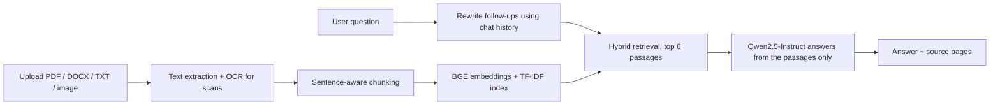

# Ask Your Doc

A retrieval-augmented generation (RAG) web app that lets you upload documents and chat with them. Answers are generated from your files only and come with the source passages and page numbers they were based on.

**Live demo:** https://huggingface.co/spaces/labdhiraisoni/ask-your-doc


## Features

- **Multiple formats:** PDF, DOCX, TXT, Markdown and images (PNG/JPG).
- **OCR for scans:** image-only PDF pages and images are read with Tesseract.
- **Hybrid retrieval:** semantic search (BGE embeddings) combined with keyword search (TF-IDF), so both meaning and exact terms like names, numbers and emails are matched.
- **Chat with memory:** follow-up questions such as "what about the second one?" are rewritten into standalone questions before searching.
- **Grounded answers:** the model is instructed to use only the retrieved context and to say when the answer is not in the documents.
- **Source citations:** every answer shows the passages and page or section used.
- **Summary mode:** broad requests ("summarize this document") sample passages across the whole document instead of relying on similarity search.
- **Login and session isolation:** username/password authentication through environment secrets; each browser session has its own document index.

## How it works



| Step | Details |
|---|---|
| Extraction | `pypdf` for text PDFs, `pypdfium2` + Tesseract OCR for scanned pages, `python-docx` for Word files (tables included) |
| Chunking | Sentence-aware chunks of about 150 words with overlap; oversized sentences are split by word count |
| Retrieval | `BAAI/bge-small-en-v1.5` embeddings (65%) + TF-IDF with bigrams (35%), min-max normalized and combined |
| Generation | `Qwen/Qwen2.5-1.5B-Instruct` on GPU, `Qwen2.5-0.5B-Instruct` on CPU (override with `LLM_NAME`) |
| Interface | Gradio, deployed on Hugging Face Spaces (ZeroGPU) |

## Tech stack

Python, PyTorch, Hugging Face Transformers, Sentence-Transformers, scikit-learn, Gradio, Tesseract OCR, pypdf, pypdfium2, python-docx.

## Run it yourself

**Option 1: Google Colab (easiest).** Open `notebooks/PDF_QA_RAG_v2.ipynb`, set the runtime to a T4 GPU, and run all cells.

**Option 2: locally.** Requires Python 3.10+ and Tesseract installed (`brew install tesseract` on macOS, `sudo apt install tesseract-ocr` on Ubuntu).

```bash
git clone https://github.com/labdhisoni/ask-your-doc.git
cd ask-your-doc
pip install -r requirements.txt gradio
python app.py
```

A GPU is recommended. On CPU the app falls back to the smaller model.

## Configuration

| Variable | Purpose | Default |
|---|---|---|
| `APP_USERS` | Enables login. Format: `user:password,user2:password2` | unset (no login locally; required on Spaces) |
| `LLM_NAME` | Hugging Face model used for answers | Qwen2.5-1.5B (GPU) / 0.5B (CPU) |
| `MAX_OCR_PAGES` | Maximum OCR'd pages per PDF | 60 |

Credentials are read from environment variables (Space secrets) and are never stored in the code.

## Limitations

- Answer quality is limited by the small open-source model; reasoning across many pages can fail.
- Tables, charts and handwriting are read poorly or not at all.
- Documents and chats are held in memory per session and are not saved.
- Retrieval and answer quality have not yet been formally evaluated on a benchmark set.

## Roadmap

- Build an evaluation set and report retrieval and answer accuracy
- Add a reranking step
- Stream answers token by token
- Persistent storage and "Sign in with Hugging Face"

## Repository layout

```
app.py              Gradio app (extraction, indexing, retrieval, chat, UI)
requirements.txt    Python dependencies
packages.txt        System packages for Hugging Face Spaces (Tesseract)
notebooks/          Colab version of the project
```
